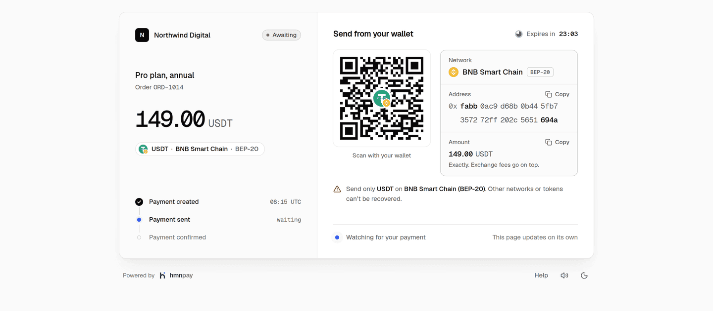
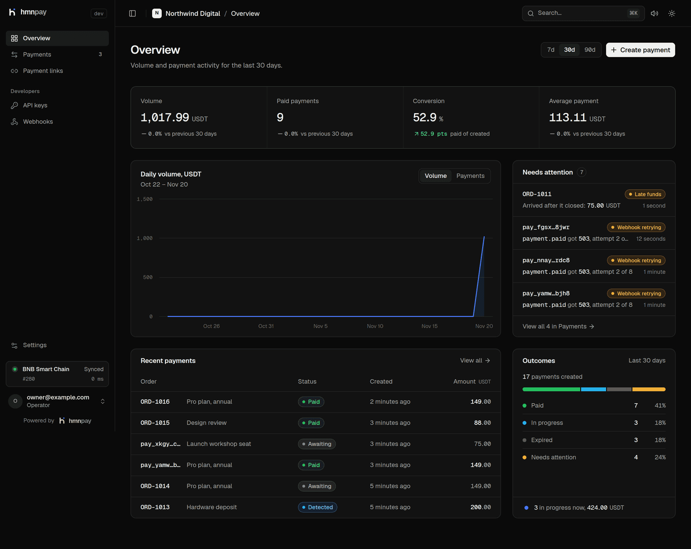

<p align="center"></p>

<h1 align="center">hmnpay</h1>

hmnpay is a self-hosted, **non-custodial** payment gateway for stablecoin
payments: you run one binary on your own server, it gives each order its own
deposit address in **your** wallet, watches the chain until the money has
arrived and is final, and tells your shop by webhook. It only ever sees your
wallet's extended public key (xpub), so it cannot move or lose funds — they
go straight to addresses whose private keys stay in your wallet. One
instance serves one merchant. This beta supports **USDT (BEP-20) on BNB
Smart Chain** only; other networks and USDC are planned, not available. It
is not a hosted service, not an exchange, does no currency conversion or
refunds on your behalf, and holds no keys.

A payment is **paid** when the money has arrived, the transfer has the
configured confirmations (15 by default), *and* the chain has finalised the
block that holds it, as two of your RPC endpoints attest. On BNB Smart
Chain mainnet that takes about 15 to 25 seconds after the transfer's block,
typically 17 (30 to 50 blocks; three measurements against real transfers).
Until then the payment is *confirming*. A transfer is never reported paid on
confirmations alone, nor for being deep (see [*"Paid" waits for
finality*](#when-payments-are-refused)).

> [!IMPORTANT]
> **Beta.** hmnpay has **not** had an independent third-party security
> audit. Read [`SECURITY.md`](SECURITY.md) for what has and has not been
> checked and how to report a vulnerability, and start with amounts you can
> afford to have delayed.

<p align="center">
  
</p>
<p align="center">
  
</p>

- [What you need](#what-you-need)
- [Quick start](#quick-start): [Docker Compose](#with-docker-compose) · [from source](#from-source)
- [Integrate it with your shop](#integrate-it-with-your-shop)
- [API endpoints](#api-endpoints)
- [Development](#development)
- [Operator guide](#operator-guide): configuration, the web interface,
  webhooks, recovery, backups, RPC usage, trust in RPC endpoints, node status
- [License](#license)

## What you need

- **Your wallet's xpub** — the extended public key (`xpub…`) of an account
  (`m/44'/60'/0'`) of a wallet you control. Deposit addresses are derived
  below it in the standard layout, `m/44'/60'/0'/0/n`, or the older Ledger
  one, `m/44'/60'/0'/n` (Ledger Live's one-account-per-address layout
  cannot be covered by one xpub). Setup shows the first derived addresses
  so you can compare them with your wallet before you take a payment.
  Never give hmnpay a private key or a seed phrase: it refuses them.
- **At least two independent BNB Smart Chain RPC endpoints, at least two of
  which serve `eth_getLogs`** (many free endpoints do not, the
  `bsc-dataseed` nodes for example). Two URLs of one provider count as one.
  The second log endpoint is what cross-checks payments: with only one
  endpoint that serves logs, a payment that endpoint leaves out is not
  noticed. hmnpay still runs then, but it says so — at a first start (and
  after a lost checkpoint) it waits some three minutes in a named hold
  while it tells the endpoint without logs from a throttled one, and from
  then on *Settings → Network* shows "Recent blocks were settled on one
  endpoint's logs", the node status has `logs_unchecked`, and the
  `logs_unchecked` alert repeats every hour. hmnpay cross-checks them; why two matter is in
  [Trust in RPC endpoints](#trust-in-rpc-endpoints), what they cost in
  calls in [RPC usage](#rpc-usage). Setup tests each one for you. Every
  endpoint you configure has to work: hmnpay does not start reading the
  chain until two of them agree on where it ends, so one that cannot be
  reached keeps it from taking payments (see below).

  What a check of real providers found (November 2026; guidance, not an
  endorsement — providers change, and *Settings → Network* is the judge
  of the endpoints you configure): the mainstream public endpoints
  (publicnode, 48 Club, thirdweb, blastapi) served finality and agreed with
  each other throughout a ten-minute sample. The `bsc-dataseed` nodes serve
  no `eth_getLogs`, so they work only as an additional endpoint that does
  not serve logs. publicnode with 48 Club ran steadily on mainnet: a first
  processed block in under a second, no disputes, no holds. Free tiers that are heavily rate-limited are unsuitable,
  and so is any endpoint that falls behind the chain: one was found forty
  minutes stale.
- **For production, a domain with TLS** in front of hmnpay (a reverse proxy
  such as Caddy or nginx), because customers pay on its checkout pages and
  the dashboard signs in with a cookie. For trying it out, `localhost` is
  enough.
- To run it: **Docker** with Compose, or to build it from source **Go 1.26+**,
  **Node.js 22** with **pnpm 12** (`corepack enable` provides the exact
  version `package.json` pins; with a system-wide Node.js on Linux it needs
  `sudo`), `git` and `make`. Building needs no C compiler.

## Quick start

Either way you end on the **first-run setup** page, which asks for a setup
token the server prints at start, then for your account, the RPC endpoints,
the xpub and your business name. For the endpoints, two public ones that
both serve `eth_getLogs` do for a start — for example
`https://bsc-rpc.publicnode.com` and `https://rpc-bsc.48.club` (see [What
you need](#what-you-need)).

### With Docker Compose

```sh
git clone https://github.com/lubluniky/hmnpay.git
cd hmnpay
cp .env.example .env
docker compose up -d --build
docker compose logs hmnpay | grep -A2 'enter this setup token'
```

Open <http://localhost:8080/setup> and enter the token. The port is
published on 127.0.0.1 only; see [Docker Compose in
production](#docker-compose-in-production) before you expose it.

### From source

```sh
git clone https://github.com/lubluniky/hmnpay.git
cd hmnpay
corepack enable                 # once per machine: the pnpm version package.json pins
make build                      # the web interface, then ./hmnpay with it inside
HMNPAY_LISTEN=127.0.0.1:8080 ./hmnpay
```

The server prints a banner with the setup token; open
<http://localhost:8080/setup> and enter it. Data goes to `./data`. Without
`HMNPAY_LISTEN` it listens on every interface (`:8080`); details in
[Building from source](#building-from-source).

## Integrate it with your shop

Once setup is done, your backend talks to the REST API under `/api/v1`
with an API key, and your customers pay on the hosted checkout.

**1. Create an API key** in the dashboard under *Settings → API keys*. For
creating payments and reading them back it needs the scopes
`payments:write` and `payments:read`. The secret (`hmn_live_…`) is shown
once; keep it on your server.

**2. Create a payment** when the customer checks out:

```sh
curl https://pay.example.com/api/v1/payments \
  -H "Authorization: Bearer $HMNPAY_API_KEY" \
  -H "Content-Type: application/json" \
  -H "Idempotency-Key: order-1001" \
  -d '{"amount": "49.00", "order_id": "ORD-1001", "description": "Pro plan",
       "redirect_url": "https://shop.example.com/orders/1001"}'
```

The answer (`201`) is the payment: its `id` (`pay_…`), `status`
(`awaiting`), the deposit `address`, `amount`, `expires_at` (30 minutes
by default, `ttl_seconds` changes it) and the **`checkout_url`**. Amounts
are decimal strings in USDT. With the same `Idempotency-Key` a retry gets
the same payment back (`200`) instead of a second one. Optional fields:
`customer_email`, `metadata` (string to string), `ttl_seconds`. A `503`
means "not now, nothing was created": `chain_not_ready` for the first
seconds after setup, `clock_behind` or `network_invalid` until the operator
fixes the server's clock or its network settings (see [When payments are
refused](#when-payments-are-refused)). Send the same request again after
the time its `Retry-After` header gives; a client that does so is never
rate-limited for it.

**3. Send the customer to `checkout_url`.** The checkout shows the amount,
the address and a QR code, follows the payment live and, once it is paid,
offers the way back to your `redirect_url`.

**4. Fulfil the order on the webhook.** Add an endpoint under *Settings →
Webhooks* (its signing secret, `whsec_…`, is shown there). hmnpay `POST`s
every event as JSON — `payment.paid` (or `payment.overpaid`: paid, with
more than was asked) is the one to ship on; the others
(`payment.detected`, `payment.confirming`, `payment.underpaid`,
`payment.expired`, `payment.failed`, `payment.late_funds`, …) are listed
in the dashboard. Verify the
`Hmnpay-Signature` header against the **raw** request body before you
trust it. In Node.js ([`docs/examples/verify-webhook.mjs`](docs/examples/verify-webhook.mjs),
tested against the server's own signatures):

```js
import { createHmac, timingSafeEqual } from "node:crypto"

/**
 * Checks the Hmnpay-Signature header of a webhook request: "t=<unix seconds>,v1=<hex>",
 * with a second v1= while a secret is being rotated. v1 is the HMAC-SHA256, under the
 * endpoint's signing secret (whsec_…), of "<t>.<raw request body>".
 *
 * body must be the raw bytes of the request (a Buffer or a string), not re-serialised JSON.
 */
export function verifyHmnpaySignature(header, body, secret, toleranceSeconds = 300, now = Date.now() / 1000) {
  if (!secret) throw new Error("no webhook signing secret configured")
  let t
  const signatures = []
  for (const part of String(header ?? "").split(",")) {
    const [key, value] = part.trim().split("=")
    if (key === "t") t = value
    else if (key === "v1") signatures.push(value)
  }
  if (!/^\d+$/.test(t ?? "") || signatures.length === 0) return false
  if (Math.abs(now - Number(t)) > toleranceSeconds) return false // a replayed request
  const expected = createHmac("sha256", secret).update(`${t}.`).update(body).digest()
  return signatures.some((signature) => {
    const given = Buffer.from(signature ?? "", "hex")
    return given.length === expected.length && timingSafeEqual(given, expected)
  })
}
```

```js
// e.g. with Express: keep the raw body for the signature
app.post("/hmnpay", express.raw({ type: "application/json" }), (req, res) => {
  if (!verifyHmnpaySignature(req.get("Hmnpay-Signature"), req.body, process.env.HMNPAY_WEBHOOK_SECRET)) return res.sendStatus(400)
  const event = JSON.parse(req.body)
  if (event.type === "payment.paid" || event.type === "payment.overpaid") markOrderPaid(event.data.order_id, event.data.id)
  res.sendStatus(200)
})
```

Answer with any 2xx within 10 seconds; failed deliveries are retried for
about 22 hours. Deduplicate on the event `id` and order events by `seq`
([Receiving webhooks](#receiving-webhooks) has the details). In Go,
`core.VerifyWebhookSignature` in this module does the same check. You can
also poll `GET /api/v1/payments/{id}` (scope `payments:read`) instead of,
or as well as, using webhooks.

Payment links (*Payment links* in the dashboard, or `/api/v1/payment-links`)
are the no-code alternative: a fixed or customer-chosen price at
`https://pay.example.com/l/<slug>`, which anybody can open.

## API endpoints

There is no separate API reference yet; this table is the routing table of
`internal/httpapi/routes.go`. Request and response shapes are the types in
`internal/httpapi/dto.go` and the core's views (`core/views.go`), mirrored
field by field in [`apps/web/src/lib/api/types.ts`](apps/web/src/lib/api/types.ts).
"Operator" means the dashboard's session; an API key needs the scope shown
(the operator can do everything). Errors are JSON:
`{"error": {"code": "…", "message": "…", "fields": […]}, "request_id": "…"}`.

| Method and path | Who | What |
|---|---|---|
| `GET /healthz`, `GET /readyz` | public | liveness; readiness including the chain watcher |
| `GET /api/v1/setup` · `POST /api/v1/setup/probe-rpc`, `/setup/preview-addresses`, `/setup/complete` | public until setup is done (needs the setup token) | first-run setup |
| `POST /api/v1/auth/login` · `POST /api/v1/auth/logout` · `GET /api/v1/auth/me` | public · public · any | the dashboard's session |
| `GET /api/v1/instance` | any | the running version |
| `POST /api/v1/payments` | `payments:write` | create a payment |
| `GET /api/v1/payments` · `GET /api/v1/payments/{id}` | `payments:read` | list (filters, cursor pages) and read payments |
| `GET /api/v1/payments/{id}/detail` | `payments:read` (deliveries: `webhooks:manage`) | a payment with its transfers, timeline and webhook deliveries |
| `POST /api/v1/payments/{id}/cancel` | `payments:write` | cancel an open payment |
| `POST /api/v1/payments/{id}/resolve` · `/reopen` | operator | mark an issue (underpaid, overpaid, late funds) as handled, or reopen it |
| `GET /api/v1/overview` · `GET /api/v1/events` · `GET /api/v1/node-status` | `payments:read` | statistics; the event log (`?after=<seq>`); the chain watcher's health |
| `GET`, `POST /api/v1/payment-links` · `GET`, `PUT`, `DELETE /api/v1/payment-links/{id}` · `POST …/{id}/activate`, `…/deactivate` | `links:write` | payment links |
| `GET`, `POST /api/v1/webhook-endpoints` · `GET`, `PUT`, `DELETE …/{id}` · `POST …/{id}/test` | `webhooks:manage` | webhook endpoints |
| `POST /api/v1/webhook-endpoints/{id}/rotate-secret` · `…/reveal-secret` | operator | signing secrets |
| `GET /api/v1/webhook-deliveries` · `GET …/{id}` · `POST …/{id}/resend` | `webhooks:manage` | the delivery log |
| `GET`, `POST /api/v1/api-keys` · `POST /api/v1/api-keys/{id}/revoke` | operator | API keys |
| `GET /api/v1/settings` · `PUT /api/v1/settings/merchant`, `/payments`, `/network`, `/wallet` | operator | instance settings |
| `GET /api/v1/operator` · `POST /api/v1/operator/password` · `GET /api/v1/operator/sessions` · `DELETE …/sessions/{id}` | operator | the account and its sessions |
| `GET /api/v1/public/payments/{id}` · `GET …/{id}/stream` | public | what the checkout shows; its live event stream (SSE) |
| `GET /api/v1/public/links/{slug}` · `POST …/{slug}/payments` | public | a payment link's page; open a checkout from it |
| `GET /license.txt`, `/additional-terms.txt`, `/third-party-notices.txt` | public | the licence texts the binary carries |

## Development

```sh
make test          # gofmt, go vet, go build, go test -race (the Go gate)
make web-test      # lint, typecheck and unit tests of the web interface
make e2e           # builds, then the end-to-end tests (below)
```

`make test` runs the race detector, which needs a C compiler (on Debian
and Ubuntu `build-essential`, on macOS the Xcode command-line tools).

The **end-to-end tests** run the real binary against a local chain — Foundry's
`anvil` and `cast` must be installed — with the real BSC-USD bytecode
(fetched once from a public BSC node and cached in `apps/web/e2e/.cache`),
in the locally installed Google Chrome (on Linux, `npx playwright install
--with-deps chrome` in `apps/web` installs it with the libraries it needs).
`pnpm --filter web e2e network.spec.ts` runs one spec (`make build` first);
`HMNPAY_E2E_WORKERS` sets the parallelism (default 2). They pass on macOS and
on Linux (Ubuntu 24.04), with 2 workers and with 4.

**Working on the interface:** run the Next.js dev server and the Go server
side by side and open the Go server's port; it proxies every page to the
dev server, so the API and the pages share one origin as in production:

```sh
pnpm install
pnpm dev                                                        # Next.js on :3000
HMNPAY_WEB_UPSTREAM=http://localhost:3000 go run ./cmd/hmnpay   # then open http://localhost:8080
```

More in [Developing the interface](#the-web-interface) (what the
development proxy does and does not forward) and
[Screenshots](#the-web-interface). Security reports: [`SECURITY.md`](SECURITY.md).

# Operator guide

## Running hmnpay

hmnpay is one static Go binary with one data directory. It needs no
database server, no Redis, no Node.js and no other service: it talks to BNB
Smart Chain JSON-RPC endpoints and to your webhook receivers, and serves its
API and its web interface — the dashboard, the setup wizard, the hosted
checkout and the payment-link pages — on one port.

### Building from source

Go 1.26 or newer (no C toolchain), and Node.js 22 with pnpm to build the
web interface (22 is the version `.nvmrc`, `package.json` and the
Dockerfile name, and the one it is built and tested with; the pnpm version
is pinned, with its hash, in `package.json` — `corepack enable` gets
exactly that one):

```sh
make build                    # builds the interface, then ./hmnpay with it inside
./hmnpay                      # same as "hmnpay serve"; listens on :8080, data in ./data
```

`make build` is two steps. `make ui` (`scripts/build-ui.sh`) builds the
interface — a static export of `apps/web`, plain HTML, JS, CSS and fonts —
into `internal/webui/dist`, which the Go package `internal/webui` embeds;
`make go` compiles the binary (`CGO_ENABLED=0`, reproducible flags). The
built interface is not committed to the repository. Once the dependencies
are installed (`pnpm install`, `go mod download`) the build needs no
network: nothing is fetched at build time, the fonts included.

With only Go installed, `go build ./cmd/hmnpay` still works: the result is
a server with the complete API and **no web interface** — it says so in its
log and on a status page at `/`, and setup is then done through the API.
The Docker image always has the interface.

Release builds stamp the version: `make build VERSION=1.0.0` (the `COMMIT`
is taken from git), or by hand
`-ldflags "-X github.com/lubluniky/hmnpay.Version=1.0.0 -X github.com/lubluniky/hmnpay.Commit=$(git rev-parse --short HEAD)"`.

### Docker Compose in production

```sh
cp .env.example .env          # adjust; every variable is documented there
docker compose up -d --build
```

The image is built in two stages — the web interface with Node.js, then
the binary with the interface embedded — and contains only that binary. It
is distroless (no shell), runs as an unprivileged user on a
read-only root filesystem without capabilities, keeps its state in the
`hmnpay-data` volume mounted at `/data`, and checks its own health with
`hmnpay healthcheck`.

Compose publishes the port on **127.0.0.1 only**. Ports published by Docker
bypass host firewalls such as ufw, so publishing on all interfaces would
expose the instance even where the firewall says otherwise. Two supported
patterns:

1. **Reverse proxy on the host** (recommended): Caddy/nginx terminates TLS
   and forwards to `127.0.0.1:8080`. Set `HMNPAY_PUBLIC_URL=https://pay.example.com`
   and `HMNPAY_TRUSTED_PROXIES` to the proxy's address as the container sees
   it: the gateway of the Compose project's network, which is usually *not*
   `172.17.0.1` — look it up with `docker network inspect <project>_default`.
   A wrong value makes every visitor share one rate-limit bucket.
2. **Deliberately public**: `HMNPAY_BIND=0.0.0.0` in `.env` — only with TLS
   terminated elsewhere, and never before setup is completed.

### Configuration

Only deployment-level settings are environment variables (each has a flag
of `hmnpay serve`; flags win; `hmnpay serve -h` lists them):

| Variable | Default | Meaning |
|---|---|---|
| `HMNPAY_LISTEN` | `:8080` | listen address |
| `HMNPAY_DATA_DIR` | `./data` (`/data` in the image) | database directory |
| `HMNPAY_PUBLIC_URL` | — | external base URL, e.g. `https://pay.example.com` |
| `HMNPAY_ALLOWED_HOSTS` | — | extra Host names the API answers for (others get 421) |
| `HMNPAY_SETUP_TOKEN` | generated | first-run setup token (≥ 20 random characters) |
| `HMNPAY_TRUSTED_PROXIES` | — | reverse proxies whose `X-Forwarded-*` headers are believed |
| `HMNPAY_TRUSTED_ORIGINS` | — | extra origins allowed to make cookie-authenticated writes |
| `HMNPAY_CORS_ORIGINS` | — | origins allowed cross-origin bearer-token API access |
| `HMNPAY_PUBLIC_CORS` | `false` | open the public checkout endpoints to any origin |
| `HMNPAY_LOG_LEVEL` / `HMNPAY_LOG_FORMAT` | `info` / `text` | logging (`json` for log shippers) |
| `HMNPAY_WEBHOOK_ALLOW_PRIVATE` | `false` | allow webhooks to private networks |
| `HMNPAY_WEBHOOK_ALLOWED_PREFIXES` | — | loopback/private CIDRs webhooks may reach anyway |
| `HMNPAY_WEBHOOK_REQUIRE_HTTPS` | `false` | refuse plain-http webhook URLs |
| `HMNPAY_RPC_DENY_PRIVATE` | `false` | setup probe refuses loopback/private RPC URLs |
| `HMNPAY_CHAIN_VERIFY` | `auto` | chain cross-check: `auto`, `best-effort`, `strict` |
| `HMNPAY_WEB_UPSTREAM` | — | **development only**: a dev server (`pnpm dev`, `http://localhost:3000`) to reverse-proxy non-API paths to, instead of the built-in interface; see [Developing the interface](#the-web-interface). Never set it in production |
| `HMNPAY_WEB_UPSTREAM_ALLOW_REMOTE` | `false` | allow that upstream to be a host other than this machine (development only) |
| `HMNPAY_SHUTDOWN_TIMEOUT` | `30s` | bound of a graceful shutdown |
| `HMNPAY_MAX_HEAD_TIME_AHEAD` | `2m` | refuse chain heads this far ahead of the server clock, and payments while the clock is this far behind the chain (`off` = escape hatch) |
| `HMNPAY_POLL_INTERVAL` | `3s` | pause between chain scans while a payment is open or a transfer is not final yet (`1s`–`30s`); see [RPC usage](#rpc-usage) |
| `HMNPAY_IDLE_POLL_INTERVAL` | `30s` | pause between chain scans while there is nothing to watch, or closed payments only (poll interval–`5m`; `off` or the poll interval disables it: every scan then follows the poll interval) |

Everything else — operator account, network, RPC endpoints, the wallet's
extended public key, merchant name — is set in the **first-run setup**:

1. Start the server. While setup is pending it prints a plain-text banner
   to stderr (also in JSON log mode; never into the structured log) with
   the setup URL and a **setup token**:
   ```
   ========================================================================
     hmnpay: FIRST-RUN SETUP REQUIRED
     This instance has not been set up yet. To claim it, open
         https://pay.example.com/setup
     and enter this setup token:
         q8n4…(32 characters)…
   ```
   Find it with `docker compose logs hmnpay`. The token is new on every
   start until setup is done (or set your own with `HMNPAY_SETUP_TOKEN`).
2. Open the setup page and enter the token; without it, the setup API
   answers 401/403, so whoever reaches the port first cannot claim the
   instance.

Behind a TLS reverse proxy you must set **both** `HMNPAY_PUBLIC_URL` and
`HMNPAY_TRUSTED_PROXIES`; otherwise cookies are not `Secure`, client IPs are
the proxy's, and the API answers only for `localhost`/IP Host headers (any
other Host gets 421 — DNS-rebinding protection; add internal names with
`HMNPAY_ALLOWED_HOSTS`). The server warns at start when it listens on a
non-loopback address without `HMNPAY_PUBLIC_URL`.

What to do when something is wrong is under
[Troubleshooting](#troubleshooting).

### When payments are refused

Four answers mean that the instance cannot create a payment at the moment.
Each is a `503` with the error code and a `Retry-After` header, takes
nothing (no payment, no address, no use of a link) and, on the public
payment-link route, does not spend the client's own rate-limit budgets: a
client that retries after the time the header gives is never answered
`429` for it.

| Code | `Retry-After` | When | The operator sees | A payer on a payment link sees |
|---|---|---|---|---|
| `chain_not_ready` | 5 s | The chain watcher has not processed its first block yet — normally a second or two after setup, a change of network or a restart (ten to fifteen seconds after a restart without the watcher's checkpoint). If it lasts, an endpoint cannot be used (see *Troubleshooting*). | "The server has not finished reading the chain yet", with the Network page one click away; the indicator says "Starting" or "Not started". | "Getting your payment ready"; the page tries again by itself. After 45 seconds: "Payments are paused for the moment", try later or contact you. |
| `clock_behind` | 60 s | The server's clock is more than `HMNPAY_MAX_HEAD_TIME_AHEAD` (2 minutes) behind the chain: a deadline would be set early. It lasts until the clock is corrected. | "The server's clock is behind" — waiting does not fix it; the Network page names it. | The same as above. |
| `network_invalid` | 60 s | The stored network settings break the rules new ones are held to (settings an earlier version accepted, such as two URLs of one endpoint): no chain watcher runs. It lasts until they are repaired. | "The network settings need repair"; the indicator says "Not running"; the Network page marks the wrong entry. | The same as above. |
| `watch_list_full` | 60 s | Payment links only: their share of the chain watch list (5,000 addresses) is used up. Your own integration's payments are not refused. | The Network page says payment links are closed for the moment. | The page says too many payments are open right now and to try again later. |

Payment rules worth knowing:

- **"Paid" waits for finality.** A transfer counts towards *paid* — the
  status, the `payment.paid` event and its webhook, *overpaid*,
  *underpaid*, *late funds*, everything a merchant acts on — only when
  both hold: its block is at or below the newest block the chain has
  **finalised**, and it has the configured number of confirmations. The
  confirmations are a floor, never a substitute for finality. The
  finalised block is the highest block that two of your endpoints attest —
  each reports it as finalised, or as below its finalised block, with the
  same header, its timestamp included; one endpoint that claims a higher
  one is not believed about it. With two endpoints that is the lower of
  their two finalised blocks. With a third endpoint configured, it is asked when the two disagree (one reports no finalised
  block, or one the other does not have, or one far behind) and whenever
  the lower of the two keeps a payment from being final: the finalised
  block is then the highest one that two of the three attest, and the one
  that dissents is named. With two endpoints, a payment that waits only
  because one of them finalises a little behind the other waits for it,
  and the node status names it ("finality dispute: … waits for …") while
  it does. That can only happen below the processed head, where payments
  are paid; on BNB Smart Chain, which finalises a block or two behind its
  tip, both endpoints' finalised blocks are normally above the processed
  head, so providers whose finalised blocks differ by a block — as they
  routinely do — cost nothing and raise no dispute. Whether a chain
  has finality is the network's, not the endpoints' to say: BNB Smart
  Chain (mainnet and testnet, the networks hmnpay supports) has it, so no
  block is ever final for being deep. Endpoints that stop reporting
  finalised blocks make nothing new final, and what two endpoints attested
  stays final — also when the watcher loses its checkpoint: the core keeps
  the final block with its processed head, hands it to the watcher when it
  starts, and never lowers it. On BNB Smart Chain with fast finality
  working this costs nothing: the chain finalises a block a block or two
  behind its tip, long before the processed head (16 blocks behind the
  tip) and the 15 confirmations reach it. Measured on mainnet (0.45 s
  blocks, two public endpoints that both serve logs), third-party USDT
  transfers were paid 30 to 50 blocks after their block: about 15 to 25
  seconds, typically 17 (three runs: 14.7 to 24.2 s with a median of 18.0,
  14.1 to 20.0 s with 16.6, 14.3 to 19.1 s with 16.5).
  When finality stalls, or the endpoints disagree about it, payments stay
  *confirming*, with all their confirmations, and do not expire — it fails
  closed. The payment says why (`awaiting_finality`: the next block it
  waits for and the newest final block — in the API, the events and the
  public checkout — whenever any of its money has its confirmations and is
  not final), the node status counts them (`awaiting_finality`, and a
  sentence in `warnings`; `head.final` is the newest final block, which can
  be above `head.number` for a while), an endpoint that reports no
  finalised block, another block, or one far behind the others' is named
  ("finality dispute: …" in `warnings`), and a `finality_stalled` alert is
  raised when no new block has become final for 2 minutes while the chain
  went on — also before the first processed block, and whatever the scan
  does meanwhile — and every hour for as long as that lasts. The
  dashboard shows such a payment as *Finalising* (with the block it waits
  for and the newest final block on its page), and the checkout tells the
  payer that the payment has been received and that there is nothing more
  to do. Until two
  endpoints have attested a finalised block — on a first start, or after
  an accepted contradiction of finalised history — no processed block is
  reported: on a first start payments are refused with `chain_not_ready`,
  otherwise confirmations and expiries wait, and the node status says why
  in `hold`. What can still take back a payment reported as paid is a
  reorganisation that replaces a block the chain had finalised — a failure
  of the chain's consensus, or the endpoints that attested it both lying
  about finality: see *Known limits*.
- **Deadlines and the server clock.** A deadline — a payment's expiry, the
  hour or the week its address is watched after it closes — is counted
  from the server clock, or from the time of the last block hmnpay has
  processed if that is later, and it is judged by both: an invoice expires
  only once the server clock *and* the chain are past its deadline. A
  clock that runs ahead, or steps forward after a payment was created,
  only makes deadlines later; one that steps back delays them. A clock
  that is behind would set them early, so while it is more than
  `HMNPAY_MAX_HEAD_TIME_AHEAD` (2 minutes) behind the chain — by the last
  processed block, or by the newest block as two endpoints show it — no
  payment is created: the API and payment links answer 503 `clock_behind`
  (`Retry-After: 60`), and the node status warns about clock skew. One
  endpoint's word is not enough: when the endpoints disagree — one's newest
  block ahead of the server clock, the other's behind — nothing is refused,
  and the node status names the dispute among its `warnings` ("clock
  dispute: …"). Within
  those 2 minutes a deadline can be that much early. A clock that is
  behind while no endpoint can be reached shows nothing to compare with:
  payments created then are early by the clock's error. With
  `HMNPAY_MAX_HEAD_TIME_AHEAD=off` nothing is refused and deadlines follow
  the chain's time whenever it is later than the clock — that is, what the
  endpoints say: a lying endpoint can make deadlines later, never earlier.
  The dashboard says "The server's clock is behind" where a payment is
  created and on the Network page; a customer on a payment link is asked,
  after a short wait, to try again later or to contact you.
- **Underpayment tolerance** is capped at 5% of each payment's amount.
- **Limited payment links** (a link with a maximum number of uses) give the
  customer 10 minutes to pay instead of the normal payment window. A
  checkout holds one of the link's uses until then; money that arrives
  later is shown as *late funds* for you to refund or honour, and never
  counts as a use, so a limited link is not oversold. One client (IP
  address) can open two checkouts of a link, then one every 5 minutes; a
  checkout the link refuses ("used up", below the minimum) does not count
  against that, so a customer who was turned away can still check out when
  a use frees up (refusals still count against the per-address budget of
  five checkout requests, then one a minute; a checkout refused because
  the instance cannot take payments at the moment — `chain_not_ready`,
  `clock_behind`, `network_invalid`, `watch_list_full` — counts against
  neither).
- **Links where the customer chooses the amount have a minimum**: 1 USDT,
  or more if you set one on the link (`min_amount`; it cannot be set below
  1 USDT). Less is refused when the checkout is opened ("the minimum
  amount is 1.00 USDT"), so a use of a limited link cannot be taken for a
  fraction of a cent. A link with a fixed price has no minimum.
- **Dust is ignored.** Funds below min(1 USDT, 5% of the amount) are
  recorded on the payment but change no status, raise no attention and
  send no webhook. The rule applies to **sums**, not to single transfers:
  while a payment is open, to everything that arrived in time; after it
  closed, to everything confirmed since you were last told (or last
  resolved the issue). Sixty USDT that arrive late in eighty pieces are
  flagged as late funds like sixty USDT in one.
- **Late payers.** A deposit address is watched for 7 days after its
  payment closes if real funds ever reached it, but only for **one hour**
  if they did not: money sent more than an hour after an unpaid invoice
  expired is not looked for. The window is about when the money was mined,
  not when hmnpay gets round to the block: money mined inside it is found
  even if the block is scanned after the window has ended (a quiet pause,
  an outage, a while on another network or token). An address leaves the
  watch list only on evidence from its own chain: once the last block
  hmnpay has processed *on that network and token*, and the newest block
  the chain has finalised, are both past its window by ten minutes of
  block time, the server clock is past it too, the time of the final block
  is known, and every block of the
  window has been scanned by two log endpoints (see *Blocks settled on one
  endpoint's logs* under [Trust in RPC endpoints](#trust-in-rpc-endpoints)).
  That it has left is recorded; nothing leaves by the clock alone. Switch
  to another network or token and back, and the old addresses whose
  window had not ended are watched again, from the block they were
  created in. "Real funds" is anything that is not dust for a
  payment you created yourself; for a payment created through a payment
  link it is at least half the amount and at least 1 USDT (anybody can
  open those). While no payment is open, these addresses are checked every
  30 seconds instead of every 3 — every block, only less often — so late
  funds on a closed payment show up to half a minute later than a payment
  on an open one ([RPC usage](#rpc-usage), *Quiet*).
- **Payment-link abuse cannot crowd out your API.** The cap on watched
  addresses (5,000) applies to link-created payments only; payments your
  own integration creates are never refused by it. The cap is also what
  bounds the load links can put on your RPC endpoints: every 500 watched
  addresses cost one `eth_getLogs` request per tick on each of two
  endpoints (measured: 5,000 addresses ≈ 12 requests per 3-second tick
  and endpoint, 20,000 ≈ 42). Your own payments count towards that load
  without a cap — with tens of thousands of open invoices, use endpoints
  that allow that many requests.

### The web interface

Everything an operator and a payer see is in the binary:

- **Setup** (`/setup`): the first-run wizard. It asks for the setup token,
  tests each RPC endpoint through the server and shows what it answered,
  derives the first deposit addresses from your xpub for you to compare
  with your wallet, and signs you in when it is done.
- **Dashboard** (`/`, `/payments`, `/payment-links`, `/settings/…`):
  overview, payments with their transfers, timeline and webhook
  deliveries, payment links (create, edit, switch off, delete), webhooks,
  API keys, the node status, the deposit wallet, your account and
  sessions. It follows the instance's event log, so it updates while you
  watch.
- **Checkout** (`/pay/<payment id>`) and **payment-link page**
  (`/l/<slug>`): what your customers see. The checkout follows the payment
  live over the event stream and falls back to polling when a stream is
  refused or breaks. Amounts are shown exactly as the API states them.

Two settings are worth knowing before you need them:

- **Settings → Network → Mainnet or testnet** moves the instance between
  BNB Smart Chain and the BSC testnet. You give it RPC endpoints of the
  other chain (each is tested first). The server refuses while any payment
  is still awaiting, detected or confirming, because that payment's address
  would stop being watched. After a switch, finished payments stay in the
  list, addresses of the old network are no longer watched (late funds
  there go unnoticed), and a payment link made for the old network refuses
  checkouts until it is opened and saved once.
- **Settings → Wallet → Next address index** sets which address of your
  key the next payment gets. The server never hands out an address that a
  payment in its database already has, even if you move the index back; it
  cannot know about addresses used anywhere else with the same key, which
  is the one risk of going back. The index must be below 2^31.

How it is served, and what that means for security:

- The interface is static files embedded in the binary. `/_next/static/…`
  assets are content-hashed and sent as `immutable`; pages are `no-store`.
  API paths never reach it: an unknown path under `/api/` is a JSON 404.
- It signs in with the session cookie the API sets (`HttpOnly`,
  `SameSite=Lax`, `Secure` over HTTPS). No token is kept in the page or in
  browser storage.
- Every page is sent with a Content-Security-Policy that allows scripts
  from the same origin and, by SHA-256 hash, exactly the inline scripts
  that page contains (the hashes are computed from the embedded files when
  the server starts): no `unsafe-inline` or `unsafe-eval` for scripts, no
  other origin. `connect-src 'self'`: the pages talk to this server only.
  `frame-src`, `object-src` and `worker-src` are `'none'`. Styles allow
  inline (`style-src 'self' 'unsafe-inline'`), which the interface needs
  for layout and motion. Images may come from `https:`/`http:` because a
  merchant logo can be a URL. Pages cannot be framed
  (`frame-ancestors 'none'`, `X-Frame-Options: DENY`) — so the checkout
  cannot be embedded in an iframe on your site — and send no referrer.
- Addresses a merchant or an API caller supplies (return URLs, the support
  page, the logo) are used only if they are `http(s)` URLs (the logo may
  also be an inline bitmap); everything from the API is rendered as text.
- The pages a payer sees always show "Powered by hmnpay". There is no
  setting that hides it (see [License](#license)).

**Developing the interface.** Run the backend and the Next.js dev server
side by side, and open the backend's port — it proxies every non-API path
to the dev server, so the API and the pages share one origin exactly as in
production:

```sh
pnpm install
pnpm dev                                              # Next.js on :3000
HMNPAY_WEB_UPSTREAM=http://localhost:3000 go run ./cmd/hmnpay   # then open http://localhost:8080
```

`HMNPAY_WEB_UPSTREAM` is a development aid and must not be used in
production; the server logs a warning at start while it is set. The
upstream serves every page of the instance's origin, so a script it serves
runs with the operator's session: it is trusted completely. What the
server does to bound that:

- only a loopback upstream is accepted (`localhost`, `127.0.0.1`, `[::1]`),
  unless `HMNPAY_WEB_UPSTREAM_ALLOW_REMOTE=true`;
- `Cookie`, `Authorization`, the setup token and the headers the API uses
  to recognise a same-origin request (`Origin`, `Referer`, `Sec-Fetch-*`)
  are not forwarded, so the upstream never holds a session or an API key;
- `Set-Cookie`, `Clear-Site-Data` and CORS headers of its answers are
  dropped;
- the Host rule applies to proxied pages as to everything else;
- its answers are sent with the server's own security headers, replacing
  whatever it sent, and a development Content-Security-Policy. That policy
  is the real one with what `next dev` cannot work without: `script-src`
  also allows `'unsafe-inline'` and `'unsafe-eval'` (inline scripts that
  change with every edit, fast refresh), `connect-src` names the page's own
  host for `ws:`/`wss:` (hot reload), `worker-src` allows `'self' blob:`
  and `font-src` allows `data:`. Other origins, frames, objects and
  `<base>` stay forbidden, and the pages cannot be framed.

`pnpm lint`, `pnpm typecheck` and `pnpm test` (unit tests) need nothing
else. `make e2e` runs the end-to-end tests: the real binary against a local
chain (Foundry's `anvil` with the real BSC-USD bytecode, fetched once from
a public node and cached) in the locally installed Chrome — first-run
setup, a payment paid on-chain and followed live, top-ups, payment links,
webhooks, API keys, the recovery code, an RPC endpoint that dies and comes
back (the watcher's warning, the hold, the recovery), a switch to a second
local chain, and more. They also check every API
response against the client's types (`apps/web/src/lib/api/types.ts`), so
a change to the API's shapes that the interface has not followed fails
there. `HMNPAY_DEMO=1 pnpm --filter web build` additionally builds the
component styleguide at `/design`; it is not part of a normal build.

Screenshots: `pnpm --filter web shots` seeds a local chain through the real
binary and captures every screen in both themes (into `.shots/`, or
`HMNPAY_SHOTS_DIR`); `pnpm shots --routes "/payments,/settings" --email …
--password …` captures chosen routes of an instance that is already
running.

### Receiving webhooks

Every webhook is a `POST` of one event as JSON, signed in the
`Hmnpay-Signature: t=<unix seconds>,v1=<hex>` header (HMAC-SHA256 of
`<t>.<raw body>` with the endpoint's secret; during a secret rotation a
second `v1=` signs with the previous one; `core.VerifyWebhookSignature`
implements the check):

```json
{"id":"evt_…","type":"payment.paid","created_at":"…","data":{…payment…},"seq":1234}
```

- `data` is the payment as `GET /api/v1/payments/{id}` returns it at the
  time of the event: `status`, `amount_received`, `confirmations` and
  `required_confirmations`, and `awaiting_finality` — `null`, or, while a
  payment has all its confirmations and waits only for the chain to
  finalise its block, `{"block": <its block>, "final": <the newest final
  block>}`. `payment.confirming` is sent when the full amount is on the
  chain; `payment.paid` follows only once the block is final, so ship on
  `payment.paid` (or `payment.overpaid`), never on `payment.confirming`.
- `id` (also in `Hmnpay-Event-Id`) is stable across retries and resends:
  deduplicate on it.
- `seq` is the event's position in the instance's event log (the same
  number as `seq` in `GET /api/v1/events`): it grows with every event, in
  the order things happened. **Order events by `seq` and ignore stale
  ones:** keep the highest `seq` applied per payment and drop an event
  whose `seq` is lower — its `data` is an older snapshot of the payment.
  Retries and resends keep their `seq`; the `webhook.test` event has none,
  and it is the only one: deliveries queued by a version from before `seq`
  get it on upgrade.
- Delivery order: hmnpay makes the first attempts to one endpoint in event
  order, one at a time — the next event's first attempt starts when the
  previous one's has finished, successfully or not. Retries (after 1, 5,
  15, 60, 180, 360 and 720 minutes) are not ordered: a failed event does
  not hold up the ones after it, so after any failure events can arrive
  out of order. While an endpoint is failing (its last attempt failed),
  first attempts are not ordered either. Answer quickly (any 2xx within
  10 seconds): a slow receiver delays every later event.

### Troubleshooting

- **Nothing ever confirms, and the node status shows refused heads or
  "The server's clock is behind the chain"**: the server clock is behind.
  Fix time synchronisation (NTP, chrony); payments are refused meanwhile
  (`clock_behind`). `HMNPAY_MAX_HEAD_TIME_AHEAD=off` is the last-resort
  escape hatch.
- **"Not started — An endpoint can't be used"**, and creating a payment
  answers `chain_not_ready` for more than a few seconds: one of the
  configured RPC endpoints cannot be reached (a mistyped URL, an expired
  provider key, a node that is down). With two or more endpoints hmnpay
  processes its first block only once two of them agree on where the chain
  ends. *Settings → Network* names the endpoint; correct it, or remove it
  there (with a single endpoint left, hmnpay trusts that one alone). The
  same endpoint going down later, once payments are running, holds their
  confirmations instead — the node status names it in its hold ("… cannot
  be reached") — until it answers again or you remove it.
- **"Not running — The network settings need repair"**, and payments answer
  `network_invalid`: settings saved by an earlier version break a rule
  (see *Upgrades*). *Settings → Network* says what is wrong and marks the
  entry ("Same endpoint as #1", "Can't be used"); correct or remove it, and
  the watcher starts as soon as the list is saved.
- **"Two endpoints disagree about the time"** (`clock dispute` in the node
  status): one endpoint's newest block puts the server clock on one side,
  the other's on the other. Payments are still taken — one endpoint's word
  does not refuse them — but one of the two serves a wrong time or a stale
  chain: check both and replace the one that is wrong.
- **A payment stays *confirming*** — in the dashboard *Finalising*, with
  "Waiting for the chain to finalise block N; finalised so far: M": it has
  all its confirmations, and the chain has not finalised its block yet.
  For a few seconds that is normal. If it lasts, *Settings → Network* says
  why: "The chain has stopped finalising blocks" (the `finality_stalled`
  alert; the chain, or every endpoint, reports an old finalised block —
  check the chain on a block explorer), or "Two endpoints disagree about
  finality" (`finality dispute: …` in the node status, naming both: one is
  behind or wrong about which blocks are final). With two endpoints, replace
  the one that is wrong, or add a third: two of three settle it, and the
  node status then names the one that dissents. The payment
  does not expire meanwhile, nothing is lost, and it becomes *paid* by
  itself once the block is final; the payer's checkout says the payment was
  received.
- **"These look like one provider"**: two endpoints whose host names share a
  registrable domain are probably one opinion, not two. Replace one with
  an endpoint of another provider (see *Independent means independent*).
- **"Payment links are closed for the moment"** (`watch_list_full`): too
  many link checkouts are open or recently closed; an unpaid one leaves the
  list about an hour and ten minutes after it closed, once the chain has
  finalised past that — longer while finality stalls. Your own payments
  are not affected.

### Locked out?

```sh
hmnpay reset-password                                  # prompts twice, no echo
docker compose exec hmnpay hmnpay reset-password       # in the container
hmnpay reset-password --generate                       # prints a strong password once
```

It works while the server is running, sets the new password, signs out
every session — a login that was in flight with the old password
included — and makes every browser an unknown device again, immediately.
It then prints what the instance is configured for:

```
Password changed for owner@example.com. 2 dashboard session(s) signed out.

Instance configuration:
  Operator:           owner@example.com (since 2026-11-18)
  Network:            chain 56, USDT 0x55d398326f99059ff775485246999027b3197955
  Wallet xpub:        xpub6Ce9NcJv…YSYwHsnJxqP
  Derivation path:    m/44'/60'/0'/0  (12 address(es) handed out)
  First deposit addr: 0xf39f…2266  <- compare with address #0 in YOUR wallet
  RPC endpoints:      https://bsc-rpc.publicnode.com, https://rpc-bsc.48.club
  API keys:           3 active of 3
  ...
```

**Check the wallet.** If you did not configure it, someone else set up your
instance and payments go to their wallet: stop the server, move the data
directory aside and start over. `--revoke-api-keys` additionally revokes
every API key (resetting the password alone does not). `hmnpay inspect`
prints the same summary without changing anything.

`reset-password` also prints a one-time **recovery code** (valid 15
minutes, one login). After a reset every browser counts as a new device
and shares a global login budget that anonymous traffic can exhaust; if the
login page says "too many attempts", enter the recovery code together with
the new password. It never replaces the password. The browser you log in
with is remembered from then on, also across server restarts.

If you know the password and are only kept out by "too many attempts" on a
browser the instance does not know, you do not need a reset:

```sh
hmnpay recovery-code                                   # prints a one-time code, changes nothing else
docker compose exec hmnpay hmnpay recovery-code
```

It works while the server is running; an earlier code stops working.

Only one server may run per data directory (`serve` takes an exclusive
lock on `hmnpay.lock`; a second one refuses to start). The operator tools
do not take it.

### Data and backups

All state is in `HMNPAY_DATA_DIR`: `hmnpay.db` plus `hmnpay.db-wal` and
`hmnpay.db-shm`. The database runs in WAL mode, so **copying `hmnpay.db`
alone while the server runs can produce a torn or stale backup**. Either
stop the server and copy the whole directory, or take an online snapshot
with SQLite itself:

```sh
sqlite3 data/hmnpay.db ".backup 'hmnpay-backup.db'"     # consistent, while running
# or: sqlite3 data/hmnpay.db "VACUUM INTO 'hmnpay-backup.db'"
```

With Docker, run that against the volume from a container that has
`sqlite3`, or stop the service (`docker compose stop`) and archive the
volume. The database holds no private keys (hmnpay is non-custodial and only
ever sees an xpub), but it does hold the operator's password hash, API-key
hashes, webhook signing secrets, your RPC endpoint URLs (including any
provider API keys in them), the device-cookie signing key and your payment
history: protect backups accordingly. Losing the database loses the
payment records, never the funds.

The chain watcher keeps its checkpoint in the same database. If it is lost
or unreadable on its own, the watcher starts again from what the payment
engine has processed and re-examines every transfer that is not final yet:
no payment the engine knows of is lost. What is lost is what only the
checkpoint knew:

- which endpoints have served logs and which have none. It is learnt
  again; meanwhile a log endpoint that is throttled the first time it is
  asked is waited for (three refusals over three minutes) and then treated
  as one without a log service until it answers — see the exception below;
- which blocks were settled on a single endpoint's logs and not yet
  re-scanned by a second one. They are not re-scanned, and the addresses
  kept for that re-scan leave the watch list at the end of their window;
- the start position, if the engine has processed nothing yet either. A
  watcher without one starts only when two endpoints agree on where the
  chain ends (within 64 blocks, or a third endpoint decides).

### Upgrades

The first public release is the baseline: upgrades are supported from it
onward, from any release to any later one. A new release migrates the
database when it starts, in one transaction; if that fails, nothing has
changed. **Downgrades are not supported**: a release refuses to open a
database a later release has migrated ("unsupported schema version"), and
nothing converts it back. Take a backup (above) before every upgrade; to
go back, stop the server, restore that backup and start the earlier
release. The chain watcher's checkpoint is in the same database and goes
back with it. What happened after the backup was taken is not in it:
payments created since are unknown to the restored instance (the money
paid to them is in your wallet all the same). Between two releases with the
same database, an earlier one cannot read the chain watcher's checkpoint a
later one wrote: it discards it with an alert (`checkpoint_discarded`) and
starts again from what the payment engine has processed, losing only what
the checkpoint alone knew (the list above).

Settings an earlier version accepted can break a rule new ones are held to
— two URLs of one endpoint, for example (differing only in their path, key
or spelling of the host), which are now refused. After the upgrade the
server starts and the dashboard works, but no chain watcher runs and no
payment is created (`network_invalid`): the dashboard says "Not running —
The network settings need repair", and *Settings → Network* says what is
wrong and marks the entry ("Same endpoint as #1"). Correct or remove it
there; the watcher starts as soon as the list is saved.

### RPC usage

hmnpay polls: every scan of the chain is a handful of JSON-RPC calls on
each of two endpoints, whether it finds anything or not, and providers bill
by the call. What it costs **per endpoint** (two endpoints that both serve
logs, default settings; a batch member counts as one call, as providers
count it):

| | Calls per scan | Scans | Health check | Calls per minute | Calls per day |
|---|---|---|---|---|---|
| **Idle** — nothing to watch | 5 | every 30 s | 2 calls every 30 s | 14 | ≈ 20,000 |
| **Quiet** — 1 to 500 watched addresses, all of closed payments | 7 | every 30 s | 2 calls every 30 s | 18 | ≈ 26,000 |
| **Active** — a payment is open or a transfer is not final; 1 to 500 watched addresses | 7 | every 3 s | 2 calls every 15 s | ≈ 127 (at most 148) | ≈ 183,000 (at most 213,000) |
| each further 500 watched addresses, active | + 2 | | | + ≈ 35 (at most 40) | + ≈ 50,000 (at most 57,600) |
| each further 500 watched addresses, quiet | + 2 | | | + 4 | + ≈ 5,800 |
| **One log endpoint** — active, the other endpoint serves no `eth_getLogs` (e.g. `bsc-dataseed`); on the endpoint that does | | every 3 s | | 149 to 162 (measured) | ≈ 215,000 to 233,000 |

(A scan takes some 0.4 s on a real network, so a minute holds about 17
three-second scans, not 20: the "at most" figures are without that. The
numbers are pinned by tests — `TestRPCUsage`, `TestIdleCallRate`,
`TestQuietCallRate`. The idle and active rows were measured on BSC mainnet
as well, with publicnode and 48 Club, both serving logs: 127 to 142 calls a
minute each while active. The quiet row was measured against a local chain:
a quiet scan is an active scan, made a tenth as often. The one-log-endpoint
row was measured on mainnet with publicnode and `bsc-dataseed`: the endpoint
that serves logs then carries every log query alone, and goes above the
"at most" of the two-log-endpoint figures.)

The three states:

**Active**: a payment is open — awaiting its money, partly paid, or
confirming — or a transfer somewhere is still waiting for its
confirmations. hmnpay scans every `HMNPAY_POLL_INTERVAL`.

**Quiet**: every address on the watch list belongs to a payment that is
closed — paid, overpaid, underpaid, expired, cancelled or failed, with
every transfer on it final. A closed payment stays on the list for late
funds (*Late payers*, above: 7 days if it was paid), and nothing else can
happen to it: its status never changes again. hmnpay then scans every
`HMNPAY_IDLE_POLL_INTERVAL`. A quiet scan is a full scan — every block
since the last one, for every watched address, on two endpoints — so
nothing is missed that an active scan would find. **What quiet costs is
this, and only this: money sent to the address of an already-closed payment
is noticed up to 30 seconds (one idle interval) after it is mined, instead
of up to 3.** From the scan that finds it, hmnpay is active again until the
transfer is final, so its confirmations and the *late funds* flag follow at
the usual pace.

**Idle**: the watch list is empty, and no transfer is waiting for
confirmations. The same interval as quiet, without the two log queries.

Leaving quiet or idle costs no time. Creating a payment — through the API
or a payment link — ends the pause at once: the scan that follows runs
within milliseconds, so the first payment after a quiet week is detected as
fast as any other. Nothing else has to: no other operation turns a closed
payment into an open one (cancelling closes; resolving an issue and
reopening it change nothing on the chain's side). The first scan after a
pause confirms that the chain it stopped on is still the chain before it
goes on. The node status says `idle: true` in both states, with
`quiet: true` when the watch list is not empty; `head` and `lag_blocks`
then show the pause (up to 30 seconds — some 85 blocks with the 16 the head
always trails) and do not make the node unhealthy. A failing endpoint is
still noticed within the idle interval. The endpoints' health is checked
half as often in both. The dashboard shows the two as healthy resting
states, "Idle — nothing to watch" and "Quiet — watching closed payments for
late funds", never as syncing or behind.

What keeps an instance active: an unpaid invoice for its lifetime (30
minutes by default), a paid one until its payment is final and some two
minutes more (the 256 blocks for which a transfer is watched for
reorganisations). After that the payment is closed, and the week its
address stays on the watch list costs the quiet rate. A shop with a few
paid orders a week pays for about 26,000 calls a day on each endpoint, not
183,000. Before there were idle and quiet scans, every instance cost the
active rate around the clock (134,000 calls a day with an empty watch
list).

Three things keep an instance from being quiet although every payment is
closed:

- **Several endpoints, of which only one serves `eth_getLogs`.** The blocks
  it scans alone wait for a second log endpoint to scan them too, and hmnpay
  stays at the poll interval so that it starts the moment one of the others
  serves logs. (The node status warns about this configuration in any
  case: `logs_unchecked`.) With a single endpoint configured there is
  nobody to wait for, and it is quiet — and trusted with everything, see
  below.
- **An endpoint that claims a longer chain than the others** — by more
  than 32 blocks, in anything it answers or in its health check. Nothing is
  settled on one endpoint's claim, but hmnpay does not rest while somebody
  says there is more chain to look at: it stays at the poll interval until
  the endpoint stops (or is removed). An honest endpoint does not do this;
  one whose block number runs ahead of its own blocks does.
- **`HMNPAY_IDLE_POLL_INTERVAL=off`**, which switches off idle and quiet
  alike.

**What the poll interval trades.** A transfer is mined at a random moment
of the pause, so it is detected half a poll interval later on average, and
a whole one at worst (plus the scan itself, about half a second); every
later step — each confirmation count, *paid* — moves at the same pace.
`HMNPAY_POLL_INTERVAL=6s` halves the active cost (≈ 100,000 calls a day
per endpoint) for 1.5 seconds more on average until a payment shows as
detected; `1s` detects within a second and a half and costs about two and
a half times the default.

**With a paid provider:**

- Count calls per endpoint and per day as in the table: about 20,000 while
  idle, about 26,000 while only closed payments are watched, about 185,000
  while a payment is open — 50,000 more for every 500 addresses beyond the
  first 500 (5,800 more while quiet). Two endpoints are two bills.
- If the active rate is more than your plan allows, raise
  `HMNPAY_POLL_INTERVAL` before you remove the second endpoint: a slower
  poll costs seconds, a single endpoint costs the cross-check ([Trust in
  RPC endpoints](#trust-in-rpc-endpoints)).
- If the idle and quiet rates matter, raise `HMNPAY_IDLE_POLL_INTERVAL`:
  `1m` is about 13,000 calls a day per endpoint while idle and 16,000 while
  quiet, `5m` about 7,200 and 7,800. The price is how late money on a
  closed payment may be noticed (up to that interval), how soon a dead
  endpoint shows up while no payment is open, and how many blocks a scan
  after the pause has to cover (at `30s` some 85, at `5m` some 670: one
  `eth_getLogs` call, or a few on a provider that caps the block range
  below that).
- A free public endpoint is a good second or third endpoint as long as it
  serves `eth_getLogs`; the request rate above is far below what public
  BSC endpoints allow.

### Trust in RPC endpoints

hmnpay learns about payments only from the JSON-RPC endpoints you
configure, so they are part of your trust base. Configure **at least two
independent endpoints** (different providers, ideally one you run), **at
least two of which serve `eth_getLogs`** — many free endpoints do not
(the `bsc-dataseed` nodes, for example). Two URLs of the same provider
count as one endpoint.

**Independent means independent.** Everything below assumes that the
endpoints you configure are run by different providers; hmnpay compares
what they say, and two endpoints of one provider are one opinion.

- Two URLs of one endpoint — the same scheme, host and port, differing only
  in the path or the query (another API key) — are refused when you save
  the network settings ("reaches the same endpoint"). Spellings of one host
  are one host: letter case, a trailing dot, an internationalised name and
  its `xn--` form, the forms of one IP address, a default port written out.
  The same identity — scheme, canonical host and port — is the name under
  which hmnpay remembers an endpoint (which blocks it scanned, whether it
  serves logs) and shows it in the node status; changing the key in an
  endpoint's path does not make it another endpoint.
- **Stored settings that would be refused now** (two URLs of one endpoint
  that an earlier version accepted) do not stop the server: it starts, the
  dashboard works, and the network settings can be repaired there. Until
  they are, no chain watcher runs on them and no payment can be created
  (503 `network_invalid`, saying what is wrong); the node status is not
  healthy, says the same in `network_problem` and as the first of its
  `warnings`, and the network settings response lists the offending fields
  in `network.problems` (like a validation error of saving them).
- hmnpay cannot know who runs an endpoint. When two endpoints' host names
  share a domain (`bsc-dataseed1.binance.org` and
  `bsc-dataseed2.binance.org`), it says that they look like the same
  provider and that the second opinion they give each other is worth less:
  in the response of the network settings (`network.warnings`) and in the
  node status (`same_provider`, and a sentence in `warnings`). The
  configuration is accepted. The comparison is by name only (the last two
  labels of the host, three under a country code such as `co.uk`;
  addresses of this machine are not compared): it cannot see that two
  unrelated names point to one provider, or that a shared domain is a
  hosting platform with independent customers.

What one faulty or malicious endpoint can do, with the others honest and
reachable (default verify mode):

| Endpoints | Forge a payment | Revert a reported payment | Hide an incoming payment | Expire an invoice early | Confirm too early | Stall |
|---|---|---|---|---|---|---|
| 1 | possible | possible | possible | possible | possible | possible |
| 2+, only one serves logs | prevented | prevented | possible if the faulty one is the log endpoint (not detected; the configuration is alerted, hourly) | prevented, except through such a hidden payment | prevented | exactly two: possible, alerted. Three or more: only the log endpoint can, alerted |
| 2+, two or more serve logs | prevented | prevented | delayed, alerted; found late while the address is watched (exceptions under *Known limits* and below) | prevented | prevented | exactly two: possible, alerted. Three or more: outvoted (logs: see below) |

Consequences worth knowing:

- **It fails closed.** Nothing is reported to the payment engine on one
  endpoint's word. If one of exactly two endpoints is down, throttled or
  disagrees — about a block, a receipt, a transfer, or simply about how
  long the chain is — payments stop confirming (and nothing expires)
  until it is back or you remove it in *Settings → Network*. Whenever
  confirmations wait, the node status names the cause and an alert
  repeats every minute; that holds for every way of waiting, including an
  endpoint whose head or log index has silently stopped while another
  endpoint shows a longer chain. Nothing is lost while it waits. (If
  *every* endpoint serves the same stale chain, nothing is waiting by
  anyone's account; that shows as a clock-skew warning — the newest block
  is old.)
- **Three endpoints keep working through one failure** for disputes about
  blocks, heights and receipts: the faulty one is outvoted and set aside,
  which costs a few seconds now and then. That includes an endpoint that
  claims the chain is shorter than the other two have it, and one whose
  log index is stuck. Disputes about the *content of logs* are outvoted
  only when three endpoints serve logs; with two log endpoints among
  three, one of them can still hold confirmations (alerted).
- **A first start needs agreement.** A new instance (or one whose
  checkpoint was lost before anything was processed) starts watching only
  when two endpoints agree on where the chain ends — within 64 blocks —
  or a third one settles it, and processes its first block only when two
  endpoints attest a finalised block. An endpoint that is still syncing keeps a
  two-endpoint instance from starting, and the node status says so.
- **No payment before the first block.** Until the watcher has processed
  its first block — normally a second or two after setup, and after a
  change of the network; after a restart, under two seconds with the
  watcher's checkpoint, and without it (lost, or discarded) ten to fifteen
  seconds with two log endpoints and minutes with one — creating a payment (API or payment link) is
  refused with 503 `chain_not_ready` and `Retry-After: 5`. Nothing is
  created and no use of a link is taken; the dashboard says what it is,
  and the payment-link page waits and tries again by itself. A payment's
  address is scanned for
  from the block after the one the watcher treated as final when the
  payment was created: the finalised block (or the processed head, if
  that is lower). Blocks above it —
  the processed head among them — can still be replaced by a
  reorganisation, and the payer's transaction mined again at a height
  below the head; it is found then, also by a watcher that starts again
  without its checkpoint. The blocks the new address is scanned for again
  are part of the next log query: measured, a start up to 64 blocks below
  the head costs no extra request, one 256 blocks below it one more
  `eth_getLogs` request per 500 watched addresses and log endpoint. Before
  the first processed
  block there is no such block, and one looked up by the creation time
  would be only as right as the server clock was at that moment.
  (Payments that versions before this one created in that state are still
  scanned from the block at their creation time.)
- **A hidden payment is found late, not lost**, when two or more
  endpoints serve logs: normally a few seconds late, longer while the
  second log endpoint is throttled or unreachable — then confirmations
  wait for it. With a single log endpoint an omission by that endpoint
  goes undetected; hmnpay warns about that configuration when it begins
  and every hour, and if you add a second log endpoint later it re-scans
  the unchecked blocks for addresses that are still watched. The re-scan is
  made by an endpoint other than the one whose logs settled those blocks,
  wherever you put the new endpoint in the list: hmnpay records which
  endpoint that was, by scheme, host and port. If you change that
  endpoint's URL, hmnpay cannot tell whether the new URL is the same
  provider, so the blocks then need scans by two of the endpoints configured
  now — with one honest endpoint among them, it is asked.
- **Blocks settled on one endpoint's logs keep their addresses watched.**
  While more than one endpoint is configured, a settled payment's address
  stays on the watch list past its window for as long as blocks of the
  window are still to be re-scanned by a second log endpoint: the re-scan
  can only find a payment to an address that is watched. The node status
  counts these addresses (`retained_unchecked`, and a sentence in
  `warnings`), and `head.checked` is the time from which blocks are
  still to be re-scanned. Their number is bounded — 5,000 — because an instance
  that stays on one log endpoint would otherwise watch every address it
  ever had: each 500 of them is one more `eth_getLogs` request per tick on
  the log endpoint. Beyond the bound the oldest are let go — those of
  payments through public links first, so that a flood of link checkouts
  cannot take the coverage of your own invoices: an `unchecked_released`
  alert, and `released_unchecked` in the node status counts them; a
  payment hidden in those blocks for one of them is not found. The count is
  the record; the alert is raised by the running process when the count
  grows, and one released in the moment the process stops is counted but
  not alerted. With a single endpoint configured nothing is kept for a second
  one — there is none — and addresses leave at the end of their window.
- **The exception: an endpoint that has never answered a log query.**
  hmnpay cannot tell a log endpoint that refuses its very first log
  queries from an endpoint without a log service (the `bsc-dataseed`
  nodes answer exactly like a throttled provider). It waits for such an
  endpoint for three refusals over three minutes — confirmations wait
  too — and then treats it as having no log service: blocks are settled on
  the other endpoint's logs (the "logs unchecked" warning), and the
  endpoint is asked again at least every half hour. Once it answers a log
  query it is a log endpoint for good, also across restarts, and the
  blocks settled without it are re-scanned. A payment the other endpoint
  hid in those blocks is found then: late — as late funds if its invoice
  has expired meanwhile. Its address is still watched (previous point),
  unless it was one of those let go beyond the bound.
- `HMNPAY_CHAIN_VERIFY=best-effort` trades this protection for
  availability in exactly one situation: when **every other endpoint has
  been unreachable** — no answer at all: connection refused, timeout, a
  gateway's 5xx — for five checks in a row (15 seconds or more), the
  remaining endpoint is trusted alone, like a single endpoint — with the
  finalised block too — until another answers again. The five checks are in a row, and nothing else may
  have answered in between: an endpoint that comes back between two checks
  — it answers the health check — and is down again by the next one starts
  the count again. And they are the remaining endpoint's own:
  if a different endpoint becomes the one that is left — the one that was
  down comes back as the other goes down — it was among those that did not
  answer, and it waits five checks of its own. That begins and ends with an alert and shows as
  a warning while it lasts. An endpoint that answers is never passed
  over, whatever it answers — a rate limit, an error, a different chain
  height: then best-effort waits exactly like the default mode. So a
  malicious endpoint has to wait for the others to be down; it cannot
  talk hmnpay into trusting it.
- **A single endpoint must be trusted completely**: it can hide, invent
  or mis-time what it reports.
- The node status (`GET /api/v1/node-status`, shown in the dashboard)
  shows which endpoint is in use (`primary`), which one verifies it
  (`verifier`), which one confirmed the latest log scans (`log_verifier`;
  empty while nothing watched needs a log scan), whether one endpoint is
  believed alone (`solo`, best-effort only), what the watcher is busy with
  when it is not at rest (`work`: a re-scan under way, transfers waiting
  for a second endpoint, blocks still to be scanned by a second log
  endpoint and what that waits for), and any hold or warning (`hold`: why
  the processed head is not moving — every hold has a reason here;
  `warnings`: endpoint disagreement, logs unchecked, server clock skew,
  endpoints that look like one provider, payments waiting for finality,
  finality stalled, a finality dispute), the newest final block
  (`head.final`, which never goes back) and the payments waiting for it
  (`awaiting_finality`: how many, the oldest block they wait for, the
  newest final block; `null` when none), which endpoints look
  like one provider (`same_provider`), and the addresses kept for, or let
  go before, a second log endpoint's re-scan (`retained_unchecked`,
  `released_unchecked`, `head.checked`). Endpoints appear as scheme and host
  only, so provider keys in the URLs are not shown. Each endpoint row has a
  one-word `state`.
- **Right after a start** (and after a change of the network settings)
  the node status says `"starting": true` until the watcher's first pass
  over the chain has completed — normally a second or two. `healthy` is
  false meanwhile, but that is not a fault, and endpoints that have not
  been asked yet show `"state": "not_checked"` without an error. A monitor
  should alert on `healthy: false` only when `starting` is false (or has
  lasted more than a minute). `/readyz` reports the same as
  `chain_healthy` and `chain_starting`. From then on the status is
  updated after every pass (every 3 seconds).

**Changing the network settings** — endpoints, the network, the token,
the confirmations — takes effect at once and cleanly: the running chain
watcher stops, and whatever it was about to report under the old settings
(a processed block, a payment it found, its status) is discarded, not
applied; a new watcher starts from the settings as they are now. That
holds for a change made in the middle of a scan, and for a change away and
back again. The settings carry a revision for that, which only grows.

**Alerts.** Besides the node status, the chain watcher raises an alert for
each condition a person should look at. Every alert is written to the
server log at error or warning level, with a sentence that says what
happened (and passed to `Config.OnAlert` when hmnpay is embedded as a Go
library); they are not webhook events. The kinds:

| Alert | What it means, and what to do |
|---|---|
| `head_held` | Confirmations and expiries are waiting: the message says for what (two endpoints that disagree, an endpoint that cannot be reached, log verification unavailable). Repeats every minute while it lasts. |
| `endpoint_fault` | An endpoint contradicted another one (another block, a block from the future, a transfer missing from its logs or known to nobody else). Nothing was taken on its word; if it keeps happening, remove it. |
| `logs_unchecked` | Blocks are being settled on one endpoint's logs, because no other endpoint serves `eth_getLogs`: a payment it leaves out is not seen. Add a second endpoint that serves logs. Repeats hourly. |
| `late_transfer` | A second endpoint found a transfer in blocks that had been settled on one endpoint's logs. It has been credited; look at the payment (it may show as late funds). |
| `unchecked_released` | Addresses left the watch list before a second endpoint had scanned blocks of their window that one endpoint's logs settled, because more were waiting than are kept (`released_unchecked` in the node status). A payment that endpoint left out for one of them will not be found. Add a second endpoint that serves logs, or bring back the one that is not answering. |
| `clock_skew` | The server's clock and the chain's newest block differ by more than a few minutes, or every endpoint serves a stale head. Fix the clock (NTP); while it is behind the chain by more than `HMNPAY_MAX_HEAD_TIME_AHEAD`, no payment is created (`clock_behind`). |
| `head_refused` | The payment engine refused a processed head stamped ahead of its clock. Nothing is recorded; confirmations wait. Usually the server clock (see `clock_skew`). |
| `single_source`, `single_source_ended` | Best-effort mode only: every other endpoint has been unreachable for five checks, so the remaining one is believed alone — and when that ends. |
| `deep_reorg` | The watcher accepted a chain that replaces blocks it had as final, or every block it remembers; the reason says which ("endpoints contradict finalized block", or "endpoints replaced every remembered block of the reorg window (the finalized block N stands)"). See *Known limits*. |
| `finality_stalled` | No new block has become final (as two endpoints attest) for 2 minutes while the chain went on — also before the first processed block, when the endpoints have not agreed on a finalised block at all: payments with all their confirmations stay *confirming* (before the first block, none can be created) until one does. Repeats every hour while it lasts; the node status says "finality stalled: …", and the Network page "The chain has stopped finalising blocks". Check the chain on a block explorer; if it is finalising there, an endpoint is reporting an old finalised block (a "finality dispute" names it) — replace it, or add a third endpoint. Nothing is lost. |
| `finality_conflict` | A payment the engine had as final is contradicted by the new chain: a block the chain had finalised was replaced. It keeps its settlement, for a person to look at. |
| `checkpoint_discarded` | The watcher's checkpoint could not be read (or was for another chain or token), or is missing while the payment engine's head says blocks are still owed a second log scan; it was rebuilt from the payment engine's state, and the record of those blocks is lost (see *Known limits*). |
| `checkpoint_repaired` | The checkpoint was not where the chain and the engine are, and the watcher went back or forward to where it has to be. |
| `fact_rejected` | The payment engine rejected something the watcher reported as malformed. It is dropped; this is a bug — please report it. |

**Known limits.** What hmnpay does not handle for you, and what you see
when it happens:

- **Two endpoints that contradict the chain hmnpay has finalized, and each
  other.** If the block hmnpay recorded as finalized, the endpoint in use
  and the verifier give three different hashes for one height, nothing is
  settled — no third endpoint is asked to decide, and nothing is credited
  or rewound. The node status warns that the last scans failed
  ("… both contradict … and each other"), and a `head_held` alert repeats
  every minute; confirmations and expiries wait until two endpoints agree
  again, or you replace the one that is wrong. Honest endpoints on a
  working chain do not produce this; it takes a stale or rewritten
  history, or a failure of finality.
- **What can still take back a payment reported as paid: a reorganisation
  that replaces a finalised block.** A transfer is
  final — *paid* — only in a block the chain has finalised (*"Paid" waits
  for finality*), so a reorganisation that keeps every finalised block
  takes back nothing that was reported as paid; it can only move transfers
  that are still confirming. One that replaces a finalised block is a
  failure of the chain's consensus (or two endpoints that both lied about
  finality). The watcher takes such a chain only when two
  endpoints show it (a single endpoint only when it insists for several
  checks), and raises `deep_reorg`; a payment the engine had as final that
  the new chain contradicts raises `finality_conflict` and keeps its
  settlement (status, amounts, the events and webhooks already sent) —
  both for a human to look at: by then the merchant may have acted on it.
  An address leaves the watch list only once the final block — not just
  the processed head — is ten minutes of block time past its window, so a
  reorganisation that keeps every finalised block cannot move money into
  the window of an address nobody watches any more. While the final
  block's time is not known (a checkpoint written before it was recorded,
  until the endpoints show that block again), no address leaves. (While finality
  stalls, settled payments' addresses therefore stay on the list and it
  grows: the cap on payment-link addresses, the warning at 20,000 watched
  addresses and `finality_stalled` apply.) Money a reorganisation that
  replaces finalised blocks puts into a block before the end of a window
  whose address has already left the watch list is not seen — nor money it
  moves at or below the finalised block that was the start of an address's
  scan (see *No payment before the first block*).
- **Finality that stalls, or that the endpoints do not agree on, holds
  payments.** Nothing is final on one endpoint's word: with two endpoints,
  if one reports no finalised block (or one the other does not have, or
  one far behind the other's), payments wait for it — the node status
  names it ("finality dispute: …"), `finality_stalled` is raised after 2
  minutes and repeats every hour, the dashboard shows the payments as
  *Finalising* and the Network page says "Two endpoints disagree about
  finality" — until it reports one, or you replace it. A third endpoint settles it
  (two of three); with two, add one or replace the one that dissents.
  Endpoints that stop reporting finality altogether hold every payment at
  the last block they agreed on, for as long as that lasts: on BNB Smart
  Chain no depth ever stands in for finality.
- **A discarded or missing checkpoint forgets which blocks one endpoint's
  logs settled.** The watcher's checkpoint records the blocks settled on a
  single endpoint's logs, still to be re-scanned by a second one. If it is
  discarded — unreadable, or of another chain or token — or missing while
  the core's head still shows such blocks (`head.checked`), that record
  goes with it, `checkpoint_discarded` is raised, and those blocks are not
  re-scanned: a payment the only log source left out of them is not found,
  and the addresses kept for them leave the watch list as their windows
  pass. (The final block is not lost with it: the core keeps it.)
- **A reorganisation that replaces every block the watcher remembers.**
  The watcher remembers blocks a reorg window (256 blocks) deep — also
  right after a start without its checkpoint, when two endpoints show it
  the block a window down; otherwise the block it started on and the
  finalised block. A fork that leaves the finalised block standing and is
  less than a window deep is an ordinary reorganisation. One that replaces
  every block it remembers, while the finalised block is further down or
  not known, may reach beyond the window: it is accepted as described
  above for a replaced finalised block, `deep_reorg` is raised, and its
  reason says which it was ("endpoints replaced every remembered block of
  the reorg window (the finalized block N stands)", or "endpoints
  contradict finalized block").
- **A repaired checkpoint can lower the watcher's own final block.** When
  the endpoints' chains end below the checkpoint for good (a checkpoint
  written while an endpoint lied about the height, two URLs of one stale
  provider), the watcher goes back to where they end and gives up what it
  remembered above, the finalised block among it — also when that block
  survives on the real chain. Until the endpoints attest a finalised block
  again, the heads it reports carry a lower final block than before. The
  core keeps its own final block (`head.final` never goes back), so no
  payment waits again or is settled differently; the watcher's lower one
  is not used. What you see is the `checkpoint_repaired` alert.
- **A log endpoint that has never answered.** If the only other endpoint
  that could check the log scans has never answered at all since the
  start, hmnpay cannot know whether it serves `eth_getLogs`. It waits for
  it — confirmations wait, the node status names it in `hold`, and
  `head_held` repeats every minute — for as long as it takes: until it
  answers, or you remove it or add another log endpoint. Three endpoints
  do not help when the third is that endpoint.
- **An endpoint is known by its address.** hmnpay remembers what an
  endpoint did — which blocks it scanned for whom — by its scheme, host and
  port. If whoever runs a host you have configured changes (a domain that
  changes hands, a host name that is pointed elsewhere), what was recorded
  for it counts for the new operator. Nothing shows it; replace the
  endpoint's URL if you know it happened, and its record no longer counts.
- **What bounds the watch list.** Payments through public links are capped
  (5,000 watched addresses); payments your integration creates are not,
  and while the processed head or the final block does not move —
  confirmations waiting, `head_held`, `finality_stalled` — no address
  leaves the list. The node status warns from
  20,000 watched addresses on (`watched_addresses`, and a sentence in
  `warnings`): every 500 of them cost one more `eth_getLogs` request per
  tick on each log endpoint.

## License

hmnpay — Copyright (C) 2026 lubluniky and the hmnpay contributors.

hmnpay is free software under the **GNU General Public License, version 3
or (at your option) any later version** ([`LICENSE`](LICENSE)), with
additional terms permitted by section 7 of that licence
([`ADDITIONAL_TERMS.md`](ADDITIONAL_TERMS.md)):

- The payment pages keep the author attribution **"Powered by hmnpay"**
  (section 7(b)). The checkout and the payment-link page show it in every
  state; a modified version must keep showing it.
- The name "hmnpay" and its logos are not licensed for other uses
  (section 7(e)).

You may run hmnpay on your own server and modify it freely. If you
distribute it, or a modified version of it, you must provide the source
under the same licence. Interfaces you write independently on top of the
API — a bot, your own storefront integration — are not covered by the
attribution term. If you need to remove the attribution, ask the authors
for permission. `ADDITIONAL_TERMS.md` is the authoritative wording; this
summary is not.

Third-party work that ships with hmnpay keeps its own licence, and the
additional terms above do not apply to it: the Geist and Geist Mono fonts
(SIL Open Font License 1.1), the vendored wave transition and the
shadcn/ui stylesheet and components (MIT), the Go modules compiled into the
binary and the JavaScript packages bundled into the interface (BSD, MIT,
ISC, Apache-2.0, 0BSD). [`THIRD_PARTY_NOTICES.md`](THIRD_PARTY_NOTICES.md)
lists every one of them with its licence text. It is generated (`node
scripts/third-party-notices.mjs`, which reads the bundle's real contents
from a source-map build).

The binary is distributed without the source tree, so it carries all three
texts and serves them to anybody who can reach it: `/license.txt`,
`/additional-terms.txt` and `/third-party-notices.txt`. The dashboard links
to them under Settings → This instance, and the Docker image also has them
as files in `/usr/share/doc/hmnpay/`.
